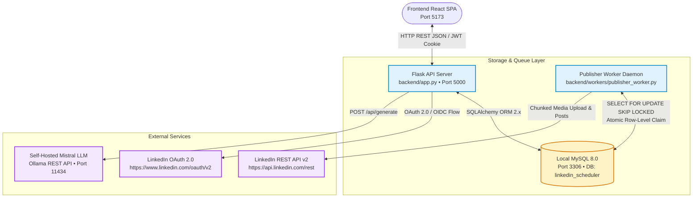

# LinkedIn Post Scheduler — Backend Engine & Worker 🛠️ 🚀

A production-grade Python backend API and autonomous background publishing engine built with Flask, SQLAlchemy 2.x, and MySQL 8.0. Features native `SKIP LOCKED` row-level queue concurrency, 32-byte Fernet token encryption at rest, official LinkedIn REST API v2 integration, and self-hosted Mistral LLM ghostwriting.

---

> [!IMPORTANT]
> **Security & Credentials Policy**:
> In compliance with strict production security standards, **no live API keys, client secrets, database passwords, or encryption keys are committed to this repository**. All secrets must be configured locally in `.env` created from the root [.env.example](file:///../.env.example). The `.env` file is strictly ignored by Git.

---

## 1. System Architecture

The high-resolution visual system architecture diagram detailing the end-to-end data pipeline, row-level queue concurrency, worker retry loops, and security boundaries is saved at [`../docs/system_architecture_diagram.png`](file:///../docs/system_architecture_diagram.png):


### 1.1 Technical Architecture Graph

The backend architecture consists of a stateless Flask REST API, an atomic MySQL 8.0 queue, an autonomous background worker daemon, and external integrations with LinkedIn's official REST API v2 and a self-hosted Mistral LLM:



---

## 2. Core Technical Capabilities

### 2.1 Native MySQL 8.0 Row-Level Lock Queue (`SKIP LOCKED`)
- **Zero Redis or Celery Overhead**: Rather than maintaining a separate Redis/RabbitMQ broker and Celery cluster, the scheduling queue uses native MySQL 8.0 InnoDB row-level locking:
  ```sql
  SELECT * FROM posts 
  WHERE status = 'scheduled' AND next_attempt_at <= UTC_TIMESTAMP() 
  ORDER BY scheduled_at_utc ASC 
  LIMIT 10 
  FOR UPDATE SKIP LOCKED;
  ```
- **Concurrency & Race Condition Prevention**: When multiple worker threads or processes execute concurrently, claimed rows immediately lock and transition to `status = 'processing'`. Other workers automatically skip locked rows without blocking.

### 2.2 Exponential Backoff with Full Jitter
- When LinkedIn returns transient errors (`429 Too Many Requests`, `5xx Internal Errors`, or network timeouts), the worker reschedules the post using exponential backoff with full jitter ($\pm 20\%$):
  $$\text{delay} = \text{base} \times 2^{(\text{attempt} - 1)} \times (1 \pm \text{jitter})$$
- **HTTP 429 Rate Limit Compliance**: If LinkedIn responds with a `Retry-After` header, the worker dynamically respects that duration.
- **Fatal vs. Transient Error Separation**: Fatal errors (`400 Bad Request`, `401 Unauthorized` token revocation) immediately transition to `failed` without wasting retry quota.

### 2.3 Fernet Token Encryption at Rest
- Sensitive LinkedIn OAuth access tokens and refresh tokens are encrypted before being written to MySQL using 32-byte URL-safe Fernet symmetric encryption (`cryptography` library).
- Decryption happens exclusively in-memory when the publisher worker initiates a verified LinkedIn API call.

### 2.4 Official LinkedIn REST API v2 Publishing
- **Authentication**: OAuth 2.0 with OpenID Connect (`openid`, `profile`, `w_member_social`).
- **Media Upload**: Binary uploads to LinkedIn DMS (`rest/images`, `rest/files`), supporting both multi-image posts and multi-page PDF documents (carousel posts).
- **Post Distribution**: Posts are published to `rest/posts` with author URNs (`urn:li:person:...`).

### 2.5 Self-Hosted Mistral LLM Ghostwriter
- Integrated with Ollama running `mistral-small:24b` or any compatible model.
- Dedicated prompt blueprints for **Professional & Standard**, **Storytelling & Milestones**, **Thought Leadership**, **Friendly & Authentic**, **Product / Announcement**, and **Hiring / Job Opening**.
- Automatic hashtag extraction and PascalCase formatting.

---

## 3. Directory Structure

```
backend/
├── app.py                      # Flask app factory, route registrations & error handlers
├── config.py                   # Pydantic Settings loaded from .env
├── db.py                       # SQLAlchemy 2.x engine & session management
├── models.py                   # SQLAlchemy ORM models (User, LinkedInConnection, Post, PostAttempt)
├── schema.sql                  # Single source of truth MySQL 8 DDL with utf8mb4 collation
├── requirements.txt            # Python dependencies
├── pytest.ini                  # Localized pytest configuration
├── ruff.toml                   # Ruff linter configuration
├── controllers/                # Request handlers & schema validation
│   ├── ai_controller.py        # AI post generation & rewrite endpoints
│   ├── auth_controller.py      # OAuth initiation, callback, profile & disconnect
│   ├── health_controller.py    # Database & service health check
│   └── post_controller.py      # CRUD, metrics, and cancel endpoints
├── services/                   # Core business logic & external integrations
│   ├── auth_service.py         # JWT session management & rate limiting
│   ├── exceptions.py           # Domain exceptions (AppException hierarchy)
│   ├── linkedin_service.py     # LinkedIn REST API v2 client (OAuth, media, posts)
│   ├── llm_service.py          # Mistral LLM prompt builder, sanitizer & tag extractor
│   ├── logger.py               # Structured JSON/console logging
│   ├── post_service.py         # Post queries, scheduling, and metrics aggregation
│   ├── retry_policy.py         # Exponential backoff with full jitter calculation
│   ├── state_machine.py        # Post lifecycle state machine transitions
│   ├── time_utils.py           # UTC time conversion & timezone utilities
│   └── token_service.py        # Fernet 32-byte symmetric token encryption at rest
├── workers/                    # Background execution engine
│   └── publisher_worker.py     # Standalone publisher daemon with SKIP LOCKED claim loop
├── scripts/                    # Maintenance & initialization scripts
│   └── init_db.py              # Automated schema provisioning & verification
├── uploads/                    # Local storage for uploaded attachments (git-ignored)
└── tests/                      # Comprehensive pytest test suite (29 tests)
    ├── conftest.py             # Fixtures, in-memory SQLite engine & test client
    ├── integration/            # test_api_endpoints.py, test_worker_concurrency.py
    └── unit/                   # test_crypto.py, test_linkedin_service.py,
                                # test_llm_service.py, test_retry_policy.py, test_state_machine.py
```

---

## 4. Prerequisites

1. **Python 3.11+** installed (`python --version`)
2. **MySQL 8.0 Server** running locally on `127.0.0.1:3306`
3. *(Optional for AI mode)* **Ollama** running locally or remotely with `mistral-small:24b`
4. **LinkedIn Developer App** with `openid`, `profile`, and `w_member_social` products approved

---

## 5. Step-by-Step Setup & Execution

### Step 1: Create Virtual Environment
Navigate to `backend/` and initialize a virtual environment:

```bash
cd backend

# Windows PowerShell:
python -m venv venv
venv\Scripts\activate

# Linux / macOS:
python3 -m venv venv
source venv/bin/activate
```

### Step 2: Install Dependencies
```bash
pip install -r requirements.txt
```

### Step 3: Configure Environment Variables
Copy the template `.env.example` file to create `.env`:

```bash
# Windows PowerShell:
Copy-Item ../.env.example .env

# Linux / macOS:
cp ../.env.example .env
```

Generate a secure Fernet token encryption key:
```bash
python -c "from cryptography.fernet import Fernet; print(Fernet.generate_key().decode())"
```

Open `.env` in your editor and configure:
- `DB_PASSWORD`: Your local MySQL root password.
- `SECRET_KEY`: A secure random 32-character string.
- `TOKEN_ENCRYPTION_KEY`: The Fernet key generated above.
- `LINKEDIN_CLIENT_ID` & `LINKEDIN_CLIENT_SECRET`: Your LinkedIn Developer App credentials.

### Step 4: Initialize the MySQL Database
Run the database provisioning script to create the schema, tables, and indexes:

```bash
python scripts/init_db.py
```
*This executes `schema.sql` against your MySQL server and sets up `linkedin_scheduler`.*

### Step 5: Start the Flask API Server
```bash
python app.py
```
*The API server will listen on `http://127.0.0.1:5000`.*

### Step 6: Start the Background Publisher Worker
In a **separate terminal**, activate the virtual environment and run the worker process:

```bash
cd backend
# Windows: venv\Scripts\activate | Linux/macOS: source venv/bin/activate

python -m workers.publisher_worker
```
*The worker continuously polls MySQL every 15 seconds for due posts and publishes them to LinkedIn.*

---

## 6. Testing & Quality Assurance

The backend includes a comprehensive `pytest` test suite containing **29 unit and integration tests** executing against an isolated in-memory SQLite database:

```bash
# Run tests with verbose output:
pytest -v

# Run with coverage report:
pytest --cov=backend
```

### Test Coverage Highlights:
- **`test_worker_concurrency.py`**: Simulates concurrent worker processes to prove atomic row locking via `SKIP LOCKED`.
- **`test_crypto.py`**: Validates 32-byte Fernet encryption and decryption round-trip.
- **`test_state_machine.py`**: Enforces strict post state transitions (`scheduled -> processing -> published | failed | cancelled`).
- **`test_retry_policy.py`**: Verifies exponential backoff math, jitter bounds, and `Retry-After` adherence.
- **`test_llm_service.py`**: Verifies prompt generation, tone blueprints, tag extraction, and asterisk stripping.
- **`test_api_endpoints.py`**: Full HTTP integration testing across all routes with authentication.

---

## 7. REST API Reference Summary

| Method | Endpoint | Description | Auth Required |
|---|---|---|---|
| `GET` | `/api/v1/health` | Service and database connectivity health check | No |
| `GET` | `/api/v1/auth/linkedin/login` | Initiates LinkedIn OAuth 2.0 flow with CSRF protection | No |
| `GET` | `/api/v1/auth/linkedin/callback` | Exchanges authorization code for tokens and issues session cookie | No |
| `GET` | `/api/v1/auth/me` | Current authenticated user profile & LinkedIn connection status | Yes |
| `POST` | `/api/v1/auth/logout` | Clears authentication session cookie | Yes |
| `POST` | `/api/v1/auth/linkedin/disconnect` | Disconnects LinkedIn account and clears author profile picture | Yes |
| `GET` | `/api/v1/posts` | List posts with pagination, status filters, and search query | Yes |
| `POST` | `/api/v1/posts` | Create and schedule a new post (Manual or AI) | Yes |
| `GET` | `/api/v1/posts/metrics` | Dashboard post counts (scheduled, published, failed, total) | Yes |
| `GET` | `/api/v1/posts/suggested-topics`| Generates personalized topic suggestions from user post history | Yes |
| `GET` | `/api/v1/posts/<id>` | Retrieve specific post details and attempt history | Yes |
| `PUT` | `/api/v1/posts/<id>` | Update commentary or reschedule (scheduled posts only) | Yes |
| `POST` | `/api/v1/posts/<id>/cancel` | Cancel a scheduled post before publication | Yes |
| `GET` | `/api/v1/posts/<id>/attempts` | Retrieve publish attempt logs and diagnostic error messages | Yes |
| `POST` | `/api/v1/ai/generate-post` | Call Mistral LLM to generate a draft from a brief | Yes |
| `POST` | `/api/v1/ai/rewrite-post` | Rewrite existing draft (shorter, formal, engaging, regenerate) | Yes |
